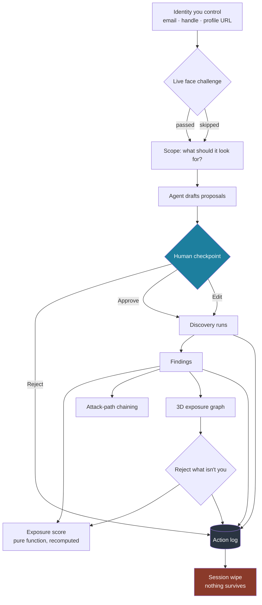

# DDU Mirror

> **Start with yourself. See what they'd see.**

A human-in-the-loop assistant for auditing your own public exposure. The agent
drafts every move it wants to make; you approve, edit, or reject it; nothing
runs until you do; and every decision lands in an append-only log.

**Secure AI Hackathon — Track 3: Human-in-the-Loop AI Assistant.**

The same intelligence techniques an attacker would point at you, aimed inward
instead. You prove the identity is yours with a live face challenge, choose
what to look for, then approve each discovery step one at a time. Findings
assemble into a 3D exposure graph as you approve them — and you can take it
apart again by rejecting what isn't you.

---

## Quick start

No API keys required. The stack runs fully offline with a deterministic
provider and cached demo data.

**Requirements:** Python 3.11+, Node 22+

```bash
# 1. Both Mirror services — trust spine :8130, intel + HITL :8120
make mirror

# 2. The UI
cd ui/ddu-ui && npm install && npm run dev
```

Open **http://localhost:5173**.

Two ways in:

- **"See a sample scan"** — straight to the workspace with synthetic findings.
  Fastest way to see the approve / edit / reject flow.
- **"Verify and begin"** — the full path: identity → live face check → scope →
  scan. Uses your webcam; the face path is skippable.

```bash
make test-mirror     # 104 tests — 5 trust spine, 85 intel, 14 UI
```

---

## The Track 3 contract

| Required layer | Where it lives |
|---|---|
| **1. User request** | Identity + scope picker — you say what to look for |
| **2. AI draft** | `POST /intel/scan/plan` — the agent proposes, never acts |
| **3. Human review** | `/scan/approve`, `/scan/edit`, `/scan/reject` |
| **4. Action log** | Append-only, rendered live in the right-hand rail |

The control lives in the application, not in a prompt. Discovery is
unreachable except through an approved proposal —
[`orchestrator.py`](services/ddu-mirror-intel/mirror_intel/orchestrator.py):

```python
if proposal.status not in (ProposalStatus.APPROVED, ProposalStatus.EDITED):
    raise PermissionError(...)
```

**Edit** is the interesting arm. Each step declares which of its inputs a human
may change; the server applies only those and hands back anything else under
`ignored` rather than silently dropping it. A change you made that the system
discarded without telling you is exactly the failure this checkpoint exists to
prevent.

---

## How it flows



Everything is in memory for the session. There is no database of findings and
no enrolment database of faces.

---

## Safety layers

Five design rules enforced in code rather than documentation:

| Rule | Enforcement |
|---|---|
| **Only you** | `assert_self` is the only path into discovery. There is no field to type someone else's name into. |
| **Third-party suppression** | Findings about people who are not the subject are suppressed, not shown. |
| **Outbound redaction** | An allowlist governs what may leave the process. |
| **Tool-less quarantine** | Untrusted text is parsed in a tier with no tool access. |
| **Irreversible needs a compensating control** | A finding that cannot be undone must carry a compensating action — enforced by a Pydantic validator, so it fails at construction. |

Every proposal names the external services it will contact **before** you
approve it, so consent is informed rather than blanket. Steps that touch
nothing outside the machine say so.

The 3D graph encodes reversibility as colour — cyan you can undo, amber you
cannot — because which parts of your exposure you can still take back is the
question the product exists to answer.


---

## Third-party services and data

Every external dependency is optional. Without a key the affected layer falls
back and **labels itself as having done so** — cached breach data is stamped
`method: "HIBP cached demo data (disclosed)"` rather than passed off as live.

| Service | Used for | Without a key |
|---|---|---|
| [Have I Been Pwned](https://haveibeenpwned.com/API/Key) | Breach findings | Cached demo set, labelled |
| Sherlock | Account discovery | Cached results |
| Anthropic | Narration and advisory tiers | Deterministic offline provider |
| ElevenLabs | Voice in and out | Text only |

Runs entirely in the browser, no key needed: **MediaPipe FaceLandmarker**
(liveness), **MapLibre GL JS** (map view), **react-three-fiber / three.js**
(3D graph).

Data: **Natural Earth** land polygons (public domain) for the landing globe;
**simple-icons** (CC0) for platform marks. Broader dependency licensing is in
[`THIRD_PARTY_NOTICES.md`](THIRD_PARTY_NOTICES.md) and
[`docs/licenses.md`](docs/licenses.md).

**No personal data ships with this repository.** Demo findings are synthetic.
The only real personal data the system touches is the operator's own, supplied
at runtime and destroyed with the session.

---

## Limitations

Said out loud, because a demo that claims nothing fails is not credible:

- **Face recognition fails unevenly across people.** The face path is therefore
  skippable and never blocks a feature — skipping labels the session
  `email-only assurance` instead of `live`.
- **Username matches are not proof of identity.** Account findings come back as
  `likely`, and you can reject any that aren't you. Rejecting breaks the attack
  paths that depended on them.
- **Breach data is cached unless a paid HIBP key is configured**, and the UI
  tells you which one you are looking at.
- **The exposure score saturates near the top of its range**, so on a heavily
  exposed profile rejecting a single finding may not visibly move the number.
- **Geolocation produces ranked hypotheses, never confirmed locations.**

---

## Repository map

| Path | What |
|---|---|
| [`services/ddu-mirror-intel/`](services/ddu-mirror-intel/) | Discovery, scoring, attack paths, HITL orchestrator, vision, voice |
| [`services/ddu-mirror/`](services/ddu-mirror/) | Trust spine — receipts, session lifecycle, wipe |
| [`ui/ddu-ui/`](ui/ddu-ui/) | React 19 + Vite front end |
| [`docs/`](docs/) | System card, runbook, privacy decisions, demo script |
| [`docs/ddu-platform.md`](docs/ddu-platform.md) | The wider pre-existing platform this was carved out of |

---

> **Start with yourself. See what they'd see.**
